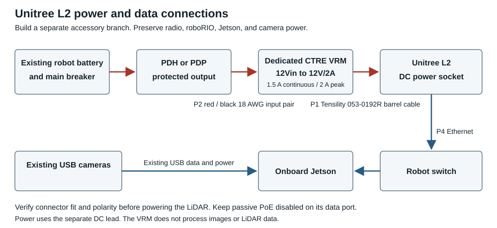
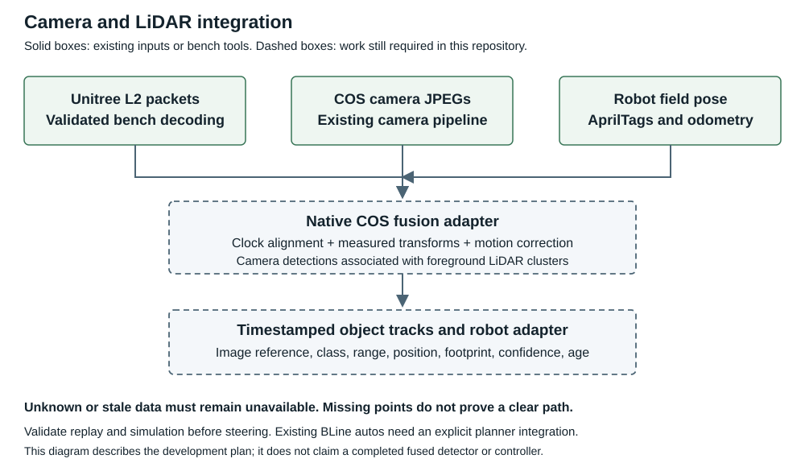
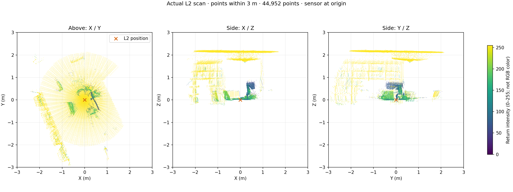

# Unitree L2 for the Team 971 software bot

This repository contains the LiDAR receiver, a local point-cloud viewer, recordings,
and the instructions for adding the Unitree L2 to the software test bot. The LiDAR
will be mounted on the robot and move with it. The onboard Jetson will process
scans beside the existing COS camera/localization stack; the roboRIO will remain
responsible for driving.

**Start with your team's instructions:**

- [Electrical Team Instructions](#electrical-team-instructions): purchase, wire, mount, and check the hardware.
- [Software Team Instructions](#software-team-instructions): run the viewer/tests, commission reception, and develop the COS integration.

## What is ready and what is still being built

| Ready for bench testing | Still required before robot avoidance |
| --- | --- |
| Native Windows Python viewer with rotation, zoom, range filtering, and stale-data status | Robot mounting and power-under-load acceptance |
| Receive-only Python, Java, and C++ decoding tools with packet validation | A native COS LiDAR source and synchronized JPEG/LiDAR recording |
| Raw packet recording and offline NumPy export | Camera/LiDAR calibration, clock alignment, and motion compensation |
| Java NetworkTables diagnostics and roboRIO subscriber example | Validated robot/ball detection, field tracks, and planner integration |
| Electrical parts list, wiring diagram, and checkout instructions | Replay/simulation and controlled moving-bot tests |

**There is not yet a camera/LiDAR fused robot-and-ball detector or an avoidance
controller ready to merge.** A slice's nearest return is a diagnostic, not proof
that a driving path is clear. Keep initial tests observation-only.

## Electrical Team Instructions

### 1 Read the build guide and confirm the bot hardware

Use the [electrical purchasing and assembly guide](docs/electrical-team-build-guide.md).
It contains the purchase links, terminal connection list, polarity procedure,
mounting instructions, address worksheet, and acceptance record.

Confirm that the CTRE board available to the team is a **Voltage Regulator Module
(VRM)** labeled **12Vin** and **12V/2A**. A CTRE PDP is a different board. Use an
available VRM dedicated to this LiDAR; preserve the existing radio, roboRIO, Jetson,
and camera circuits.



Power uses the LiDAR's separate DC lead. Ethernet carries data. The VRM has no
camera inputs, and ordinary USB camera ports cannot directly supply the L2's 12 V.

### 2 Purchase or gather these parts

| Item | Selection | What you do with it |
| --- | --- | --- |
| LiDAR power cable | [Tensility 053-0192R](https://www.digikey.com/en/products/detail/tensility-international-corp/053-0192R/568583), DigiKey **839-053-0192R-ND** | Insert its prepared leads into the VRM output and its molded **3.5 x 1.35 mm** barrel plug into the L2. Verify physical fit and polarity on one sample first. |
| VRM input wire | [AndyMark red/black bonded wire](https://andymark.com/products/18-gauge-red-black-bonded-wire), **18 AWG, 5 feet** | Cut and strip a pair from the protected distribution branch to VRM 12Vin. Skip if a suitable dedicated input is already installed. |
| Branch protection | **10 A** part matching the actual board/slot | Use the [guide's protection selection table](docs/electrical-team-build-guide.md#select-p3-for-the-installed-distribution-hardware). MINI fuses and ATO/VB3 breakers are different parts. |
| Data cable | Factory-terminated Cat5e/Cat6 RJ45 patch cable, length measured on the bot | Connect L2 to an existing robot switch data port, with passive PoE disabled. |
| Mount and retention | Bracket, four M3 screws sized for its thickness, suitable insulating hardware, cable ties and labels | Secure the sensor and strain-relieve both cables. |

The assembly is terminal wiring, not a fully plug-and-play harness. No soldered
barrel connector or custom PCB is required. The existing battery/main-breaker
wiring stays in place.

### 3 Build and check the electrical installation

Follow the [power wiring procedure](docs/electrical-team-build-guide.md#wire-the-power-path)
with the battery disconnected. Measure the original adapter's polarity and check
the new cable before attaching the LiDAR. P1's striped conductor goes to the
barrel center; plain black goes to the sleeve. Confirm the required sensor polarity.

Use **12V/2A**, not the VRM's 500 mA or 5 V output. The 2 A marking is a **peak**
rating; its continuous limit is **1.5 A**. The L2's published 10 W nominal / 13 W
heating draw makes the VRM a candidate, but startup and realistic battery-sag
behavior must be measured. Do not increase a fuse to solve a regulator limit.

### 4 Mount for balls and robots and record the transform

Use the [mounting procedure](docs/electrical-team-build-guide.md#mount-and-assemble-the-hardware).
The four M3 holes have **6 mm depth**; calculate screw engagement from the bracket
stack instead of blindly choosing a screw length. Check electrical isolation from
the robot frame and keep the optical window and airflow clear.

An upright L2 mainly scans above its base. A high upright mount can miss floor
balls. Check candidate positions/orientations with actual balls and robot-height
targets before finalizing the bracket. Record blind spots, mounting photos, the
base-center position, and sensor orientation in the agreed robot coordinate frame.

### 5 Complete the electrical handoff

Fill out the [acceptance record](docs/electrical-team-build-guide.md#test-before-releasing-the-bot).
Give software the branch/protection information, measured startup and steady
currents, minimum voltage under drivetrain load, mount transform, and coverage
results. The electrical checkout must establish stable live reception before
any steering response is tested.

## Software Team Instructions

### 1 Get this repository and run an offline viewer first

```sh
git clone --recurse-submodules https://github.com/lrspeiser/unitree4d.git
cd unitree4d
```

For an existing checkout, preserve your local changes, pull the intended branch,
and initialize its pinned SDK submodule:

```sh
git submodule update --init --recursive
```

The viewer needs Python and NumPy. In **Windows PowerShell**, use a virtual
environment; activation is not required:

```powershell
python -m venv .venv-viewer
.venv-viewer\Scripts\python.exe -m pip install -r requirements-viewer.txt
.venv-viewer\Scripts\python.exe point_viewer.py --replay tests/fixtures/l2-scan.bin
```

Open **[http://127.0.0.1:8765](http://127.0.0.1:8765)**. This demonstration repeats
one recorded scan slice, not a complete room scan. Stop it with Ctrl+C before live
reception. See [viewer and recording notes](docs/viewer-and-cos.md).

### 2 Check the sensor destination before starting live reception

The **last verified bench configuration** is:

| Device or setting | Value |
| --- | --- |
| L2 name / address | `unitree.localdomain` / `192.168.0.250` |
| L2 MAC | `0C-29-AB-7C-00-01` |
| Source / destination | `192.168.0.250:6101` -> **5090 PC `192.168.0.36:6201`** |
| Device identity | YS-L2; hardware 2.2.1.1; firmware 2.8.11.1 |

These are bench addresses, **not the robot's settings**. Recheck them before a test.
Moving the cable to the robot switch does not move the UDP destination to the Jetson.

For the 5090, with the sensor powered and still configured as above:

```powershell
.venv-viewer\Scripts\python.exe point_viewer.py --bind 192.168.0.36 --sensor 192.168.0.250
```

Only one application can receive UDP 6201 at a time. Stop any other probe or viewer.
The viewer's web page listens only on this computer's loopback interface. WSL is
useful for offline builds, but sensor unicast into WSL has not been verified; use
native Windows Python for this bench workflow.

**Do not change this PC's IP, DHCP, DNS, routes, or firewall settings.** If the sensor
must move networks, plan and explicitly approve a sensor configuration change using
[the commissioning worksheet](docs/electrical-team-build-guide.md#commission-the-robot-network)
and [the network helper](l2_network.py). Read-only `--query` and a configuration dry
run are separate from `--apply`, which writes sensor settings. Do not repeat an old
configuration command from historical notes.

Do not run the downloaded Unilidar Windows viewer or bypass Defender: the V1.21
executable was blocked as `Trojan:Win32/Ravartar!rfn`. Use this repository's viewer.

### 3 Inspect and record a stationary scene

Use **Nearby**, **Top**, **Side**, drag-to-rotate, and scroll-to-zoom. Colors show
height, not RGB. Points accumulate over 0.6 seconds and are cleared when stale.
This accumulation is not motion-corrected and is intended for stationary inspection.

For a controlled object check, keep the sensor and surrounding scene still, remove
the object, wait a second, choose **Mark empty scene**, then replace it. Orange
means returns outside the baseline's 3 cm voxels; motion, occlusion and noise also
cause changes. If the sensor moves, discard the comparison and capture a new baseline.

Record up to 60 seconds of validated scan packets:

```powershell
.venv-viewer\Scripts\python.exe point_viewer.py --bind 192.168.0.36 --sensor 192.168.0.250 --record tmp/session-01.jsonl --record-seconds 60
```

Choose a new output filename for each run. The viewer continues after recording
ends; existing recording files are not overwritten. Stop the process before
starting another receiver. Export the recording for offline analysis:

```powershell
.venv-viewer\Scripts\python.exe export_recording.py tmp/session-01.jsonl tmp/session-01.npz
```

The export contains calibrated XYZI, slice offsets, and timestamp metadata. The
recording preserves raw packets and receive/sensor clocks. Windows monotonic time
is not roboRIO FPGA time; clock alignment and point timing are not yet validated.

### 4 Run the decoder and transport tests

On Linux/macOS/WSL, install a C++17 compiler, Make, and JDK 17+ first. Use Python
with NumPy for the Python viewer tests. From the repository root:

```sh
make all test
python3 -m unittest discover -s tests -p 'test_*.py'
bash scripts/build-bridge.sh
bash scripts/test-bridge.sh
```

`make test` generates `build/reference.csv` with Unitree's C++ conversion. The
viewer tests need that file. They compare coordinates within **0.1 mm of the
reference calculation**, require exact fixture intensities, reject malformed
packets, and check bounded history. This is decoder parity, not a claim of 0.1 mm
physical ranging accuracy. The NT test uses a real local client/server and checks
LiDAR silence and a frozen publisher.

The C++ capture utility still binds the original direct-link Mac addresses. Do
not run it as though it were already commissioned for the current LAN. Use the
configurable Python/Java receivers for current-address checks.

### 5 Commission the Jetson with diagnostics only

Inventory the actual Jetson, OS, storage, running COS service, camera serials, and
robot address plan. Preserve the working localization setup. Source inspection
matches **frc971/cos** and **frc971/971-prediction-bot-2026** to **team 9972**;
confirm the physical bot rather than assuming its subnet.

Choose stable unused addresses on the existing robot LAN, then configure **the
LiDAR** to send UDP to the Jetson. Follow the guide's worksheet, save the ACK,
power-cycle the sensor, and verify live scans at the new destination. Do not
retarget a computer adapter to compensate for an uncommissioned sensor.

The existing Java bridge can provide initial NT diagnostics. After building and
testing on the Jetson, substitute its actual sensor and roboRIO addresses:

```sh
bash scripts/run-bridge.sh 0.0.0.0 <actual-lidar-ip> <actual-roborio-ip>
```

Replace the angle-bracket placeholders; they are not literal shell arguments.
The L2's destination must be the Jetson's real IP, not `0.0.0.0`. See the
[diagnostic deployment and subscriber reference](docs/frc-integration.md#robot-side-integration)
for [L2RobotInput.java](examples/wpilib/unitree4d/L2RobotInput.java) and the seven-field
`/UnitreeL2/sample` format. It reports the latest **slice**, not full-sweep obstacles.
Its independent freshness checks must be preserved. Do not install a service until
foreground reception, shutdown, and silence handling pass on the Jetson.

### 6 Build the native COS and camera fusion integration here

Use [the inspected FRC source map](docs/frc-repository-map.md) and
[the recording/COS contract](docs/viewer-and-cos.md). Keep development and proposed
integration patches in **this repository**; do not change the FRC repositories as
part of the bench work.



Implement and validate in this order:

1. **Native COS source:** bounded receive-only acquisition with source/CRC checks,
   raw packets, sequence/loss health, sensor time, host time, and safe shutdown.
2. **Synchronized recording:** pair LiDAR and camera JPEGs using a shared run ID,
   verified clock mapping and calibrated camera/sensor transforms. Add explicit
   stationary recording; COS image logging currently depends on DS enable state.
3. **Motion correction and field registration:** transform scans with the robot
   pose at their measurement times. Preserve per-point times and mark missing or
   stale pose/synchronization as unavailable. Do not treat the IMU as an established
   replacement for the AprilTag/odometry pose.
4. **Object observations:** remove robot structure/floor appropriately, cluster
   occupied surfaces, and associate camera detections with foreground LiDAR returns.
   Validate FRC robot and ball labels. Keep uncertain clusters as unknown obstacles.
5. **Tracks and robot output:** publish bounded, timestamped positions, footprints,
   velocity estimates, classification confidence, validity and observation age.
   Include an image/frame reference so detections can be inspected against JPEGs.
6. **Planner adapter:** test obstacle inflation, stale-data behavior and a hold/stop
   policy in replay and simulation before controlled low-speed driving.

Existing reusable references include [OpenCV camera projection](https://docs.opencv.org/4.x/d9/d0c/group__calib3d.html)
and [Autoware camera/LiDAR association](https://autowarefoundation.github.io/autoware_universe/latest/perception/autoware_image_projection_based_fusion/).
They do not supply a calibrated, ready-to-run detector for our bot. JPEG boxes alone
do not establish object distance; sparse/missing/occluded LiDAR must remain unknown.

### 7 Review and merge only the completed integration

Before proposing changes to the team's FRC repos, provide a reviewable patch or
copy instructions from this repo, its calibration/config files, meaningful tests,
a recording/replay example, performance measurements, and rollback instructions.
Use each target project's existing build and WPILib dependencies.

The current [`L2RobotInput.java`](examples/wpilib/unitree4d/L2RobotInput.java) example
can be copied to `src/main/java/unitree4d/` on a team-owned review branch for
**diagnostics only**; call it non-blockingly from periodic code and log its status.
Do not copy this repository's downloaded JNI libraries into a different WPILib
project. The future native COS detector and planner adapter have no completed
merge patch yet.

The prediction bot's existing autos use **BLine**. Calling PathPlanner's dynamic
obstacle API by itself will not change those autos. Explicitly integrate the
selected planner/follower and test both a crossing obstacle and publisher failure.

## Evidence and supporting documents

The preceding Mac home-LAN check decoded **641,497 points in 10.057 seconds**
with zero invalid packets or sequence gaps. Its [probe output and health record](results/home-network-2026-11-11)
are preserved alongside the original direct-link captures. The stream was later
redirected to the Windows destination listed above.



This is a static real capture colored by return properties, not an RGB image or
semantic robot/ball recognition. A controlled cup-removal test on the 5090 also
showed a compact surface disappearing while most nearby surfaces stayed in place;
that is a response check, not a trained classifier or field calibration.

- [Electrical team build guide and purchase links](docs/electrical-team-build-guide.md)
- [Viewer, recording format, and COS requirements](docs/viewer-and-cos.md)
- [5090 setup and current bench addresses](docs/windows-5090.md)
- [LAN commissioning and configuration helper](docs/home-network.md)
- [FRC repositories, camera/logging components, and planner integration points](docs/frc-repository-map.md)
- [Java diagnostic bridge and deployment examples](docs/frc-integration.md)
- [Hardware validation and limitations](docs/validation.md)
- [Original handoff](HANDOFF.md) and [original Mac setup](docs/mac-setup.md): historical direct-link notes; use the current bench addresses above.
- [License](LICENSE) and [third-party notices](THIRD_PARTY.md). Unitree's SDK remains a pinned submodule with its license intact.
