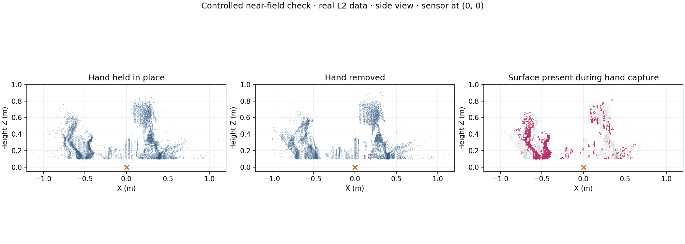

# Unitree L2: Mac verification and FRC test-bot integration

Receive and decode Unitree 4D LiDAR L2 scans on a Mac, and provide a Java 17
foundation for a Jetson-to-roboRIO integration. The real L2 was verified over
direct Ethernet on 2026-11-11. Jetson deployment and robot power tests are pending.

**Continuing on the 5090 machine:** start with [HANDOFF.md](HANDOFF.md), including
the verified state, checkout commands and implementation priorities. The
[FRC repository map](docs/frc-repository-map.md) identifies the matching COS and
test-bot code, existing camera/logging components and planner integration gaps.

## What is working

- Native C++ receive-only capture with Unitree's calibrated point conversion.
- Java 17 UDP receiver with CRC validation, bounded latest-slice storage,
  receive timestamps, source filtering and stale-data detection.
- Jetson NetworkTables bridge and roboRIO subscriber example with independent
  age checking when the sensor or publisher stops.
- Real captures, health reports, near-field plots and controlled hand-motion comparison.
- Tests against Unitree's C++ decoder and an actual local NT4 client/server connection.

The original 30-second Mac capture decoded 1,785,215 valid points with no frame,
CRC or payload errors. The Java receiver later decoded 479,880 points in 8.043 s
with zero invalid packets or observed sequence gaps. These are basic operation
checks, not absolute ranging calibration or an IMU validation.

## Start on the Mac

```sh
git clone --recurse-submodules https://github.com/lrspeiser/unitree4d.git
cd unitree4d
make all test
```

Power the L2 with its supplied wall adapter. Connect Ethernet directly to the
Mac's Ethernet adapter. Set that adapter to `192.168.1.2/24`, with no router;
the factory L2 address is `192.168.1.62`, sending UDP `6101 -> 6201`.

```sh
build/l2_mac_check 30 results/latest
python3 plot_scan.py results/latest
python3 plot_near_scan.py results/latest 1.5
java -cp build/java unitree4d.L2Probe 192.168.1.2 192.168.1.62 10
```

Run only one UDP receiver at a time. Java needs JDK 17 or newer; C++ needs a
C++17 compiler. Plotting needs NumPy and Matplotlib. Neither receiver sends
configuration commands to the L2. See [Mac connection notes](docs/mac-setup.md).

## FRC architecture

Use the **Jetson** for full point-cloud processing and recording. Send compact,
timestamped results to the **roboRIO** via NetworkTables. The included bridge
currently sends diagnostics from the latest scan slice; object detection,
mapping, full-revolution obstacle summaries and autonomous driving are future work.

Source inspection subsequently identified the team's existing native C++ **COS**
stack as the preferred Jetson integration point. The standalone Java bridge is
a verified bench foundation. The matching test-bot source uses team **9972**;
verify the physical bot before applying the earlier generic Team 971 network examples.

```text
protected robot power -> regulated 12 V -> L2 power lead
L2 Ethernet -> onboard switch -> Jetson -> NT4 diagnostics -> roboRIO
```

See [FRC wiring, addressing and deployment](docs/frc-integration.md) for actual
commands, systemd setup, a roboRIO integration example and optional PDH power
switching. The service is supplied but has not been installed on the Jetson.

## Inspect the scene

The L2 measures surface positions and return intensity. The plots show those
measurements from selected viewpoints; their colors are not RGB photographs.
A room-wide top view can be dominated by the ceiling. Near-field side views
make desk-height surfaces easier to inspect.



The hand-in-place/hand-removed comparison shows a changed nearby surface
consistent with the requested motion. This is a physical response check, not
semantic recognition of the hand, person or computer. Differences also include
motion, occlusion and the sensor's sampling pattern. The original clouds remain
available for independent inspection.

- [Initial health report](results/mac-check-2026-11-11/health.json)
- [Original scan](results/mac-check-2026-11-11/scan.ply)
- [Closer scene view](results/near-field-2026-11-11/near-preview.png)
- [Validation and limitations](docs/validation.md)

Unitree's SDK is a pinned submodule; its source and license remain intact.
Downloaded dependencies, generated executables and caches are excluded.
See [third-party notices](THIRD_PARTY.md).
