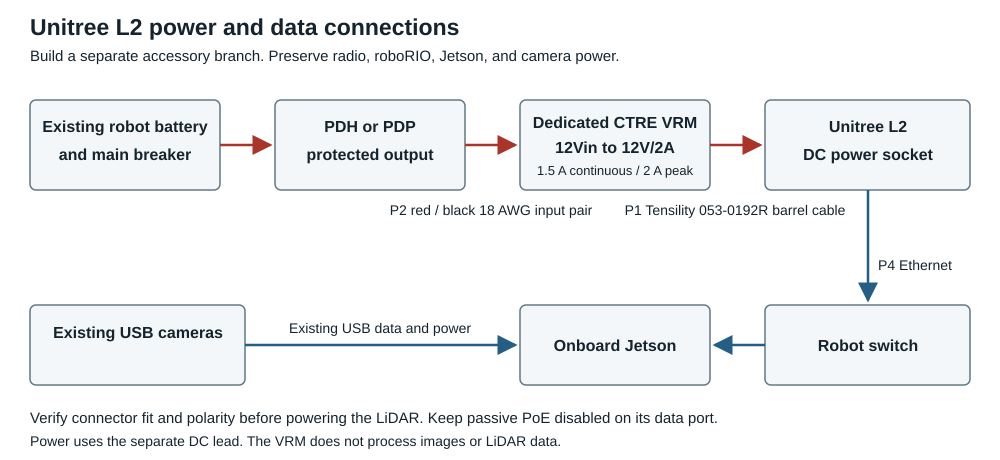

# Unitree L2 installation on the software bot

Electrical purchasing assembly and checkout guide

Team 971 software test bot | Revision 1 | November 11 2026

Install the existing Unitree L2 using a dedicated CTRE Voltage Regulator Module (VRM), the robot's existing protected power distribution, a factory-made barrel-plug cable, and Ethernet to the onboard Jetson. This guide covers purchasing, wiring, mounting, commissioning, and the electrical handoff to software. It does not authorize autonomous driving.

The assembly requires ordinary terminal wiring: two conductors from distribution to the VRM, and two prepared conductors from the barrel cable to the VRM. There is no custom PCB, soldered barrel connector, second robot battery, USB power adapter, or PoE injector in this design.

### Installation arrangement



```text
Existing robot battery and main breaker
    |
Protected distribution output
    |  P2 red and black 18 AWG pair
CTRE VRM 12Vin -> regulated 12V/2A output
    |  P1 Tensility 053-0192R barrel cable
Unitree L2 power socket

Unitree L2 Ethernet -> P4 patch cable -> switch -> Jetson
Existing USB cameras --------------------------> Jetson
```

The USB cameras keep their existing Jetson connections. Leave the radio, roboRIO, and Jetson power circuits intact. The L2 UART connector is unused and should be protected from contact with conductors. [S1, S2]

### Confirm these items on the physical bot

- The CTRE board must actually be the **Voltage Regulator Module** with **12Vin** and **12V/2A** labels. A PDP is a different device.
- Use a spare VRM or a verified available VRM dedicated to the L2. An existing radio-supply VRM is not an available accessory supply. Treat the entire 12 V regulator as reserved for the L2 in this build.
- Identify the distribution board, its unused branch, and its matching protection format before ordering the fuse or breaker. Use the [protection selection table](#select-p3-for-the-installed-distribution-hardware).
- Inspect the actual LiDAR power socket against the proposed plug. Nominal diameter alone does not prove insertion depth, retention, or polarity.

**Electrical design limit:** the VRM output labeled 2A is rated **1.5 A continuous and 2 A peak**. The L2's published 10 W nominal and 13 W heating demand calculate to approximately 0.83 A and 1.08 A at 12 V. That supports evaluating this VRM, but the assembled combination still requires the startup and drive-load tests in the [acceptance tests](#test-before-releasing-the-bot). [S1, S2]


## Purchase and gather the parts

Reuse the existing LiDAR with its three-way lead, CTRE VRM, battery/main breaker/distribution, onboard Jetson, and Ethernet switch or verified spare data port. Buy one sample barrel cable before stocking spares, because fit on this exact sensor has not been tested.

| Item | Qty | Exact part or selection | Purpose |
| --- | --- | --- | --- |
| P1 | 1 | Tensility **053-0192R**; DigiKey **839-053-0192R-ND**. 3.5 mm OD x 1.35 mm ID plug, 9.5 mm exposed barrel, 1.83 m cable, 24 AWG, stripped/tinned ends. | VRM output to L2 socket. Buy link [S3]; manufacturer drawing [S4]. |
| P2 | 1 | AndyMark **Red Black Bonded Wire**; choose **18 AWG, 5 feet**, not 22 AWG. | Distribution to VRM input. Cut to measured length. [S5] |
| P3 | 1 used | Choose exactly one protection part below, unless the VRM already has its own suitable powered branch. | Protects VRM input wiring. |
| P4 | 1 | Factory-terminated Cat5e or Cat6 RJ45 patch cable, measured to reach from L2 to the existing switch with service slack. Monoprice FLEXboot Cat6 is one source; choose the required length. | Data only. No crossover cable, USB Ethernet adapter, or energized passive PoE port. [S8] |
| P5 | 1 kit | Four M3 mounting screws, washers, rigid bracket, insulating spacers/hardware where needed, cable ties, tie mounts, and labels. | Screw length depends on the bracket stack; the mounting section specifies engagement. |

### Select P3 for the installed distribution hardware

| Available branch | Purchase or reuse | Connection choice |
| --- | --- | --- |
| REV PDH low-current MINI fuse position | AndyMark **am-4053**, **10 A MINI fuse**. | Prefer an unused non-switched branch for initial tests. Do not reuse the radio or roboRIO branch. [S6] |
| REV PDH or CTRE PDP 2.0 standard ATO breaker position | REV **REV-11-1860-PK4**, **10 A ATO auto-resetting breakers**, sold as a four-pack; use one. | Install only in a physically compatible ATO slot. [S7] |
| Original CTRE PDP ordinary breaker position | AndyMark **am-2097**, **10 A VB3-style Snap Action breaker**. | Use an unused compatible ordinary branch. This guide does not repurpose the PDP's shared VRM/PCM fused supply. [S9] |

If the team's VRM already has a suitable dedicated input branch, P2 and P3 may already be installed. No new battery connector, SB50 harness, main-breaker cable, or battery terminals are needed. Verify the existing wiring rather than buying duplicate parts.

**Cable specification matters:** P1 is the specific factory assembly above, not any visually similar small DC plug. Its manufacturer specifies a 4.5 A maximum operating-current rating; its 24 AWG wires fit the VRM's 16-24 AWG terminal range. The 2026 rules explicitly list 24 AWG for VRM 2A circuits. [S2, S4, S10]


## Wire the power path

Disconnect the robot battery before changing wiring. Keep the LiDAR unplugged while measuring the new lead. Prepare only the L2 accessory branch.

### Terminal connection list

| From | To | Cable and identification |
| --- | --- | --- |
| Selected protected distribution positive | VRM **12Vin positive** | P2 red, 18 AWG. |
| Same distribution branch negative | VRM **12Vin negative** | P2 black, 18 AWG. |
| VRM **12V/2A positive** | P1 center-contact conductor | **Black with stripe**, per the Tensility drawing; subject to polarity verification below. |
| VRM **12V/2A negative** | P1 outer-sleeve conductor | **Plain black**, per the Tensility drawing. |
| P1 molded barrel plug | LiDAR's power socket on its three-way lead | Dry-fit and verify retention first. Do not force it or cut off the sensor connector. |
| LiDAR RJ45 | Existing onboard switch data port | P4 patch cable. Keep passive PoE disabled on this port. |

Use only the VRM terminals explicitly marked **12V/2A** for this output. Do not use 12V/500mA, 5V, unregulated distribution voltage, USB, or the UART pins. The manufacturer's wire map for P1 is center = striped black and sleeve = plain black. [S2, S4]

### Verify polarity before attaching the LiDAR

1. Inspect the working wall adapter's polarity symbol. Measure DC voltage between its plug center and sleeve with insulated probes; record sign and voltage without bridging the contacts.
2. With the purchased cable disconnected from all power, use continuity mode to verify which prepared lead reaches its center contact and which reaches its sleeve. Confirm that center and sleeve are not shorted together.
3. If the sensor's original supply is center-positive as expected, wire P1's striped lead to VRM positive and plain black to negative. If the actual supply differs or a check disagrees, stop and resolve the discrepancy before connecting the sensor.
4. With the LiDAR disconnected, power the VRM and measure the finished plug. Its polarity must match the original adapter and its voltage must agree with the regulated nominal 12 V specification. Record both readings.
5. Disconnect the battery again before plugging the cable into the LiDAR.

### Prepare and retain the wires

Use a wire stripper and small flat screwdriver. The VRM calls for approximately 3/8 in (9.5 mm) stripped ends and button-operated insertion; P1 arrives with approximately 10 mm prepared ends. Follow the distribution board's own strip-length marking at P2's other end. Tug-test every termination and leave no exposed copper or whiskers. [S2]

The barrel plug is a friction connection. Anchor the cable to the bracket so cable motion does not pull on the plug, while leaving a service loop. Keep excess cable secured rather than coiled near motors or belts. P1 can be shortened and re-stripped if the electrical lead prefers a shorter run; that adds wire preparation but no soldered connector.


## Mount and assemble the hardware

The LiDAR will move with the robot. Rigid mounting and a recorded mounting position are necessary for later camera/LiDAR fusion and field coordinates. A loose sensor can still produce convincing point clouds with incorrect obstacle locations.

### Choose the mount for actual coverage

The L2 primarily scans the hemisphere above its base in its upright orientation. A high upright mount can miss balls on the floor and low nearby robot structure. Unitree permits installation in any direction. Evaluate a low mount or an appropriately oriented inverted/tilted mount with software and mechanical leads, checking bumper occlusion and protection from impacts. Do not finalize bracket holes solely from a room-wide point-cloud preview. [S1]

Place representative balls on the floor ahead and to each side, plus a broad target at another robot's bumper/body height. Use the viewer to check the proposed mounting location at multiple distances before final assembly. This is a team acceptance exercise, not a guarantee of full coverage. Never classify unobserved space as clear.

### Mechanical build sequence

1. Choose a rigid bracket tied to the robot structure. Preserve camera sight lines and leave room for Ethernet and power plug removal.
2. Use the L2's four **M3 bottom mounting holes**. Unitree specifies **6 mm hole depth**; calculate screw length from bracket, washer, and spacer thickness so engagement cannot exceed the usable depth. Verify the manufacturer drawing rather than assuming that an M3 x 6 screw fits every bracket stack. [S1]
3. Check whether the sensor's enclosure or connectors conduct to supply ground. Add suitable insulating mounting hardware if needed to preserve the robot-frame electrical isolation required by R611. Do not use the chassis as the negative return. [S10]
4. Keep the optical window clear and provide airflow around the base. Do not cover the window with a transparent protective panel; it can affect returns. [S1]
5. Mount the VRM securely with its labels and terminals accessible. Reserve its 12 V supply for this LiDAR and label the input branch **L2 VRM**.
6. Install P3 in the selected distribution position and record its channel number. Route P2 to VRM 12Vin, then P1 from VRM 12V/2A to the sensor. Verify the connection list in the [terminal connection list](#terminal-connection-list) with the battery disconnected.
7. Route P4 from the L2 to the robot switch. Anchor both cables clear of wheels, shafts, belts, intakes, sharp edges, and impact zones. Cap/protect the unused serial connector.
8. Leave the Jetson power and USB cameras on their existing connections. The VRM neither accepts JPEGs nor processes sensor data; all acquisition and processing happen on the Jetson.

### Record the mounting transform

Measure the LiDAR base-center origin relative to the robot's agreed origin, using robot +X forward, +Y left, +Z up. Record translation in meters and orientation with explicit units and rotation convention. Also photograph the mount and cable-exit direction. The L2's +X points opposite its cable outlet. Software must apply the measured transform; upside-down mounting cannot be handled by a height offset alone. [S1]

Do not move or recalibrate existing localization cameras as part of this installation without coordinating with the software lead. Any later sensor movement requires the recorded transform to be updated.


## Commission the robot network

Electrical installs the cable; software assigns and verifies addresses. The LiDAR transmits UDP to one configured receiver. Connecting its Ethernet cable to the robot switch does not automatically change its address or move the stream to the Jetson.

### Last verified bench configuration

| Setting | Last verified value on the 5090 bench |
| --- | --- |
| Sensor name and UDP source | unitree.localdomain / **192.168.0.250:6101** |
| Sensor MAC and identity | **0C-29-AB-7C-00-01**; YS-L2; hardware 2.2.1.1; firmware 2.8.11.1 |
| Data destination | **192.168.0.36:6201**, the 5090 PC |
| Mask and gateway | 255.255.255.0; 192.168.0.1 |

These bench values were verified during development. Recheck power and settings before testing; they are not a robot address plan.

### Complete the address record before changing the sensor

| Robot setting | Team records the confirmed value |
| --- | --- |
| Physical bot identity and team setting | __________________________________ |
| Existing robot subnet and mask | __________________________________ |
| roboRIO address | __________________________________ |
| Jetson interface and stable address | __________________________________ |
| Unused/reserved L2 address | __________________________________ |
| L2 destination | Jetson address above, UDP **6201** |
| L2 source port and gateway | UDP **6101**; gateway per actual subnet |

Source inspection matches COS and the prediction-bot project to **team 9972**, but that does not establish the physical bot's current subnet or deployment. Do not copy either a 10.9.71.x or 10.99.72.x example without inventorying the bot.

### Software commissioning sequence

1. While the L2 is still reachable on its known bench network, read its identity and save the existing configuration record.
2. Software stages the confirmed robot source/destination addresses with the repository's `l2_network.py` helper and reviews the dry run. An explicit `--apply` writes sensor settings; omit it during review. Do not change the 5090's networking to reach another subnet.
3. After one acknowledged write, power-cycle only the sensor and connect it to the actual robot LAN. Verify both its new reachability and live point decoding on the Jetson. If it disappears, inspect the saved record and use a suitable separate commissioning interface; do not keep issuing blind writes.
4. Run only one receiver on UDP 6201. Keep raw point clouds on the onboard wired network. The robot should receive compact detections/diagnostics, not a cloud streamed through the competition radio.

Use the repository receiver/tools, not the downloaded Unilidar Windows executable that Defender flagged. This installation requires no change to the 5090's IP, DHCP, DNS, routes, or firewall.


## Test before releasing the bot

The following are proposed team acceptance tests. No on-robot power-under-load, camera fusion, or autonomous avoidance validation has yet been completed for this assembly. Keep autonomous actuation disabled during electrical commissioning.

### First power on

1. With the battery disconnected, inspect the branch, wire gauge, terminal retention, plug polarity, and clear optical/mechanical space. Have another team member check the connection list.
2. With the LiDAR disconnected, energize the branch and record battery voltage, VRM input, and the finished plug's output/polarity. Disconnect power before connecting the L2.
3. Power the assembled sensor. Observe startup until fresh scans arrive; heating can delay output. Do not treat spinning motors, a ping reply, or LEDs as proof of valid scans.
4. Run the receiver for at least 60 seconds and record valid points, invalid packets, sequence gaps, scan age, and any restarts. Our native Windows bench receiver previously decoded millions of points; that is a bench result, not proof of Jetson performance.

### Electrical and sensing acceptance record

| Test | Pass condition | Result or measurement |
| --- | --- | --- |
| Plug and polarity | Correct seating; center/sleeve polarity agrees with working supply; no forced fit. | __________________ |
| Steady load | Measured VRM output current stays below **1.5 A continuous**; peak below **2 A**. | __________________ |
| Startup and heating | No supply cycling, thermal limiting, or repeat restarts; fresh scans eventually available. | __________________ |
| Ten minute run | No unexpected reset or hot/damaged connectors; no VRM current-limit behavior. | __________________ |
| Cable retention | Gentle cable movement cannot interrupt power/data; all terminations remain seated. | __________________ |
| Controlled drivetrain load | Log minimum input/output voltage, LiDAR health and radio connection; no LiDAR reboot attributable to sag. | __________________ |
| Ground coverage | Representative floor balls and robot-height targets appear in tested approach areas. Record blind spots. | __________________ |
| Silence handling | Power down only L2; robot software marks perception unavailable and follows the agreed hold policy. | __________________ |

Measure current with a correctly fused series ammeter or suitable DC current probe. Never place a meter set to current mode across the power output. Use a scope or fast logger if brief peak/sag behavior cannot be resolved with the available meter.

If the VRM exceeds its limits or loses regulation during realistic loads, stop and select a higher-capacity regulator verified over the measured battery range. Increasing the branch fuse does not increase VRM output capacity. Preserve logs before changing hardware.


## Operate and hand off to software

The L2's nominal 10 W draw is a modest accessory load. At 12 V and an assumed 90 percent regulator efficiency, the calculated battery current is about **0.93 A**. Three minutes of scanning uses roughly **0.046 Ah**; one hour uses **0.93 Ah**. These are estimates for the LiDAR alone. The common 18 Ah battery rating is measured at a slow discharge rate and is not a robot-runtime guarantee. [S1, S11]

Keep the sensor scanning during tests that need perception. For long idle periods, software may request its documented standby mode; Unitree specifies under 1 W in standby. Wake it early enough to re-establish fresh data, and turn the robot off when parked. Do not repeatedly cycle the LiDAR with every Driver Station enable transition. Standby and switching are operating procedures to implement/verify, not automatic behavior already installed. [S1]

### Release information for the software team

- Record the distribution channel, protection part/rating, VRM serial/label, actual cable part, plug polarity, measured startup/steady currents, and minimum voltage during the load test.
- Provide mount photos, robot-to-LiDAR transform, cable-exit orientation, coverage results, and measured blind regions. Record any subsequent movement of the mount.
- Provide the actual LiDAR and Jetson addresses, mask, ports, switch port, firmware identity, and a synchronized camera/LiDAR bench recording.
- Preserve camera serial selection and current localization calibration. COS's four vision-bot camera configs select front, left, visionbotback, and right serials; inspect the installed bot before assuming they match.

### Camera and LiDAR fusion interface

COS already supplies timestamped camera JPEGs, camera configuration, and a common robot clock. The intended extension matches calibrated LiDAR points to image detections and then places observations on the field using the robot pose at measurement time. A JPEG by itself does not contain LiDAR distance. Timestamp matching, camera intrinsics, camera/LiDAR extrinsics, and robot motion must be handled explicitly.

Autoware's image-projection fusion is an existing reference for associating 2D detections with LiDAR clusters. OpenCV supplies the projection/calibration functions suitable for a smaller COS adapter. A team-trained or validated detector is still required to assign FRC robot/ball labels. Low-confidence or unobserved objects must remain unknown obstacles rather than being discarded. [S12, S13]

The future robot-facing record should include observation time/age, camera/image reference, class/confidence, robot-relative position/range, field position, footprint, and validity. These are the planned interface requirements; the current bench viewer does not yet implement this fused detector or avoidance controller.

### Keep repository boundaries clear

All new integration code and installation instructions belong in **lrspeiser/unitree4d** for review. No FRC 971 repository was modified for this electrical guide. The inspected source pair is COS at `f6a7bf2325c6013ae1ee627824154d5953eae9e1` and prediction-bot at `66b821ccfd1d984c4d665e3fe493ecfd587d1abe`. See `docs/frc-repository-map.md` for integration locations. Confirm the installed versions before deployment.


## Reference links and build signoff

The manufacturer and rule references below were checked on November 11 2026. Prices, stock, and event rules can change. The electrical lead should verify the current event manual before competition inspection.

- [S1 Unitree L2 user manual power mounting interfaces and standby](https://oss-global-cdn.unitree.com/static/Unitree%204D%20LiDAR%20L2%20User%20Manual.pdf)
- [S2 CTRE VRM user guide ratings terminals and installation](https://ctre.download/files/user-manual/VRM%20User%27s%20Guide.pdf)
- [S3 Buy Tensility 053-0192R from DigiKey](https://www.digikey.com/en/products/detail/tensility-international-corp/053-0192R/568583)
- [S4 Tensility 053-0192R manufacturer drawing and polarity map](https://tensility.s3.us-west-2.amazonaws.com/uploads/pdffiles/053-0192R.pdf)
- [S5 AndyMark bonded wire select 18 AWG and 5 feet](https://andymark.com/products/18-gauge-red-black-bonded-wire)
- [S6 AndyMark MINI fuses am-4053 is the 10 A option](https://andymark.com/products/mini-fuses)
- [S7 REV ATO breakers select REV-11-1860-PK4 10 A](https://www.revrobotics.com/auto-resetting-breakers/)
- [S8 Monoprice FLEXboot Cat6 patch cables select route length](https://www.monoprice.com/product?p_id=9789)
- [S9 AndyMark Snap Action breakers select am-2097 10 A VB3](https://andymark.com/products/snap-action-breakers)
- [S10 2026 FRC manual R610 R611 R618 through R624](https://firstfrc.blob.core.windows.net/frc2026/Manual/HTML/2026GameManual.htm)
- [S11 WPILib Robot Battery Basics](https://docs.wpilib.org/en/stable/docs/hardware/hardware-basics/robot-battery.html)
- [S12 Autoware image projection based fusion](https://autowarefoundation.github.io/autoware_universe/latest/perception/autoware_image_projection_based_fusion/)
- [S13 OpenCV camera calibration and 3D projection](https://docs.opencv.org/4.x/d9/d0c/group__calib3d.html)

### Physical build record

| Record | Value |
| --- | --- |
| Bot identity and distribution model | __________________________________________ |
| L2 distribution channel and protection | __________________________________________ |
| VRM output and other loads | 12V/2A; L2 only / exception reviewed: __________ |
| Plug fit and verified polarity | __________________________________________ |
| Startup peak and steady output current | __________________________________________ |
| Minimum VRM output during drive test | __________________________________________ |
| Mount transform and calibration file | __________________________________________ |
| LiDAR IP and Jetson destination | __________________________________________ |
| Electrical builder and checkout date | __________________________________________ |
| Software receiver and coverage checkout | __________________________________________ |

**Release condition:** electrical checkout establishes reliable power, mechanical retention, and live sensor reception. It does not establish correct semantic labels, full obstacle coverage, or a safe avoidance controller. Complete replay/simulation and controlled low-speed testing before enabling steering responses to detections.


[S1]: https://oss-global-cdn.unitree.com/static/Unitree%204D%20LiDAR%20L2%20User%20Manual.pdf
[S2]: https://ctre.download/files/user-manual/VRM%20User%27s%20Guide.pdf
[S3]: https://www.digikey.com/en/products/detail/tensility-international-corp/053-0192R/568583
[S4]: https://tensility.s3.us-west-2.amazonaws.com/uploads/pdffiles/053-0192R.pdf
[S5]: https://andymark.com/products/18-gauge-red-black-bonded-wire
[S6]: https://andymark.com/products/mini-fuses
[S7]: https://www.revrobotics.com/auto-resetting-breakers/
[S8]: https://www.monoprice.com/product?p_id=9789
[S9]: https://andymark.com/products/snap-action-breakers
[S10]: https://firstfrc.blob.core.windows.net/frc2026/Manual/HTML/2026GameManual.htm
[S11]: https://docs.wpilib.org/en/stable/docs/hardware/hardware-basics/robot-battery.html
[S12]: https://autowarefoundation.github.io/autoware_universe/latest/perception/autoware_image_projection_based_fusion/
[S13]: https://docs.opencv.org/4.x/d9/d0c/group__calib3d.html
